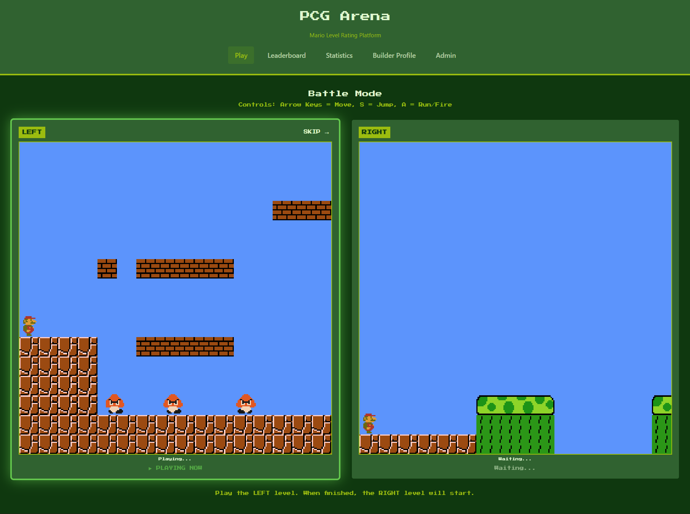
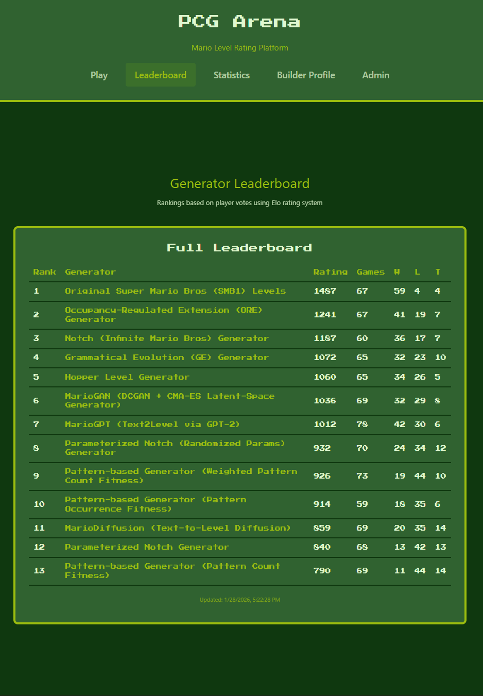

# PCG Arena

**A web platform for blind A/B testing of Super Mario Bros level generators.**

Live at **[pcg-arena.com](https://pcg-arena.com)**

<p align="center">
  
</p>

Players play two procedurally generated levels in the browser, without knowing
which generator made either one, and vote for the level they prefer (or call a
tie or skip). They can also tag each level (`fun`, `boring`, `creative`,
`too_hard`, `too_easy`, `impossible`, `broken_graphics`). The votes feed a
**Glicko-2** leaderboard, so every generator's rating comes with an
uncertainty estimate. Researchers can submit their own generators as a ZIP of
ASCII levels.

The analysis of the collected data and the preference-aligned generator built
from it (MarioDPO) are in a separate repository, **mario-dpo**.

---

## Features

- **Browser Mario engine**: a TypeScript port of the Java
  [Mario AI Framework](https://github.com/amidos2006/Mario-AI-Framework),
  with the original physics constants. Physics runs at 30 ticks/s and
  rendering at 60 FPS.
- **Blind battles**: two levels from different generators, one attempt each,
  then a vote: *Left*, *Right*, *Tie*, or *Skip*.
- **Glicko-2 ratings**: each generator has a rating, a rating deviation
  (RD), and a volatility. All rating updates are atomic and written to an
  audit log.
- **AGIS matchmaking** (Adaptive Glicko-Informed Selection): picks the next
  pair of generators by rating similarity, uncertainty, information gain,
  and pairwise coverage.
- **Telemetry**: Mario's trajectory, death locations, play duration, and tags
  are recorded for each level side, with per-level analytics pages.
- **Builder profiles**: generator submission with format validation. Each
  user can own up to 3 generators.
- **Authentication**: Google OAuth 2.0 or email/password (bcrypt, SendGrid
  verification emails).
- **Data export**: endpoints for votes, level stats, trajectories, and player
  profiles.

<p align="center">
  
</p>

---

## Repository layout

```
pcg-arena/
├── backend/            FastAPI service (Python 3.12)
│   ├── src/            main.py, glicko2.py, matchmaking.py, auth.py, builders.py, stats.py, ...
│   ├── config/         settings.env (non-secret defaults)
│   ├── scripts/        backup / restore / demo scripts
│   └── tests/
├── frontend/           React 18 + TypeScript + Vite SPA
│   └── src/
│       ├── engine/     Mario game engine (ported from Java)
│       ├── api/  components/  pages/  contexts/
├── db/
│   ├── migrations/     17 sequential SQL migrations (SQLite)
│   ├── seed/           generators.json + seed levels (13 baseline generators)
│   ├── local/          runtime SQLite DB (gitignored)
│   └── backups/        DB backups (gitignored)
├── generators/         Raw output + post-processing notebooks for the neural
│                       baselines (MarioGAN, MarioGPT, MarioDiffusion)
├── client-java/        Legacy Stage-0 Java desktop client (Swing, Mario AI Framework)
├── shared/             Placeholders for shared level-format / schema definitions
├── docs/               Stage specs, deployment, GCP, secrets, email verification
├── docker-compose.yml
└── .env.example
```

### Baseline generators

`db/seed/levels/` contains the levels used to seed the arena:

| Family | Generators |
|---|---|
| Human-authored | `original` (15 Nintendo SMB1 levels) |
| Constructive | `notch`, `notchParam`, `notchParamRand`, `hopper` |
| Chunk-based | `ore` |
| Search-based | `genetic`, `patternCount`, `patternOccur`, `patternWeightCount` |
| Neural | `mariogan`, `mariogpt`, `marioDiffusion` |

The constructive, chunk-based, and search-based levels were generated with the
[Mario-AI-Framework-PCG](https://github.com/acatai/Mario-AI-Framework-PCG)
fork, which is not part of this repository. The neural baselines were
generated from the published models and then post-processed into arena format
with the notebooks in `generators/`.

---

## Running locally

### Prerequisites

- Docker + Docker Compose
- Node.js 18+ and npm

### 1. Secrets

```bash
cp .env.example .env
# fill in SENDGRID_API_KEY, GOOGLE_CLIENT_ID, ... (see docs/secrets-management.md)
```

Do not commit `.env`.

### 2. Backend

```bash
docker compose up --build
# API on http://localhost:8080, health check: http://localhost:8080/health
```

On first start the backend applies `db/migrations/` and imports `db/seed/`.
The SQLite database is stored in `db/local/arena.sqlite`.

### 3. Frontend

```bash
cd frontend
npm install
npm run dev
# http://localhost:3000
```

For more detail, see [frontend/QUICKSTART.md](frontend/QUICKSTART.md) and
[backend/spec.md](backend/spec.md).

### Tests

```bash
cd backend
pytest
```

---

## Level format

Levels are plain-text ASCII tilemaps, 16 rows high (10–20 allowed) and
150–250 columns wide. Every row must have the same length, and only the 37
whitelisted tile characters are allowed. For example, `-` is air, `X` is
ground, `M` is Mario's spawn, `F` is the flag, `g` is a Goomba, `k` is a
Koopa, and `<>[]` are pipe tiles. The validator and the full tile whitelist are
in [backend/src/db/seed.py](backend/src/db/seed.py).

## Submitting a generator

1. Sign in and open **Builder Profile**.
2. Fill in the generator's name, version, description, and source URL.
3. Upload a ZIP of `.txt` levels in the format above.
4. The generator starts at a rating of 1000 ± 350 and enters matchmaking
   immediately.

---

## Deployment

Production runs on a GCP `e2-micro` VM: the backend runs in Docker behind
Caddy, which handles automatic TLS and serves the static frontend build. See
[docs/PUBLIC-DEPLOYMENT.md](docs/PUBLIC-DEPLOYMENT.md),
[docs/gcp-spec.md](docs/gcp-spec.md), and
[frontend/DEPLOYMENT.md](frontend/DEPLOYMENT.md).

## License

MIT. See [LICENSE](LICENSE).
